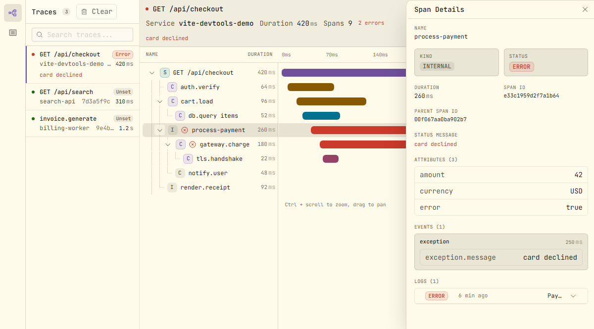
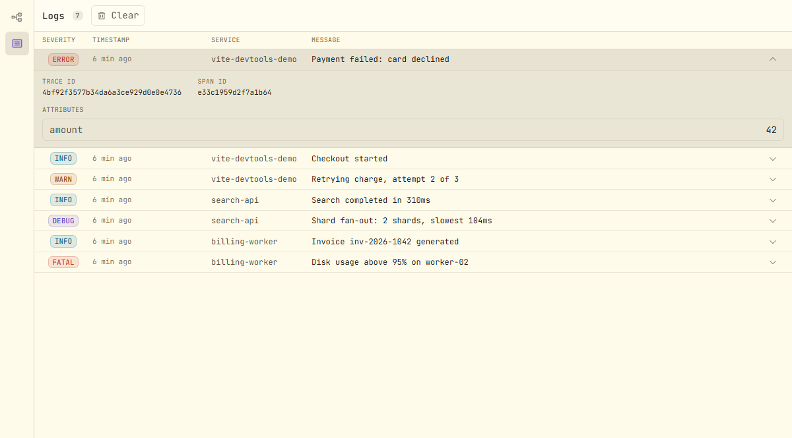

# vite-opentelemetry-inspector

OpenTelemetry traces, logs & metrics inspector as a standalone [Vite](https://vite.dev) plugin built on [devframe](https://devfra.me). Extracted from the devtools UI of [`nuxt-otel`](https://github.com/lutejka/nuxt-otel).

## Screenshots

| Traces                                                                                                                                                                                           | Logs                                                                                                                                                                                                      |
| ------------------------------------------------------------------------------------------------------------------------------------------------------------------------------------------------ | --------------------------------------------------------------------------------------------------------------------------------------------------------------------------------------------------------- |
| <picture><source media="(prefers-color-scheme: dark)" srcset="./docs/images/trace-dark.png"></picture> | <picture><source media="(prefers-color-scheme: dark)" srcset="./docs/images/logs-dark.png"></picture> |

## Install

```sh
pnpm i vite-opentelemetry-inspector
```

## Usage

```ts
import { defineConfig } from 'vite'
import { viteOpentelemetryInspector } from 'vite-opentelemetry-inspector'

export default defineConfig({
  plugins: [viteOpentelemetryInspector()],
})
```

When [Vite DevTools](https://devtools.vite.dev) is enabled, the plugin adds an **OpenTelemetry** panel to its dock during `vite dev`. Pass `devtools: false` to leave the panel out (the ingest endpoint still works).

The panel has **Traces**, **Logs** and **Metrics** tabs. The Metrics tab groups data points by metric name, shows the latest value and a sparkline per metric, and offers pinning plus a full chart view.

The panel is a devframe, so other devframe hosts can mount it too. `vite-opentelemetry-inspector/devtools` exports the definition along with helpers to feed it:

```ts
import { createOpentelemetryDevframe } from 'vite-opentelemetry-inspector/devtools'

const { definition, ingest, exposeTraces, exposeSpans, exposeLogs, exposeMetrics } = createOpentelemetryDevframe()
// mount `definition` in a devframe host, e.g. `kit.install(definition)`
```

## Ingest

`POST` OTLP JSON to the ingest endpoint (default `/__opentelemetry-ingest`):

```
{devServerUrl}/__opentelemetry-ingest
```

The endpoint accepts trace, log and metric OTLP JSON payloads (`/v1/traces`, `/v1/logs`, `/v1/metrics` shapes, or a merged body) — the same contract as `nuxt-otel`'s `{devServerUrl}/__nuxt-otel-ingest`. Point any OTel SDK or collector at it:

```ts
// Example: OTLPTraceExporter with a custom url
new OTLPTraceExporter({ url: 'http://localhost:5173/__opentelemetry-ingest/v1/traces' })
```

> Note: bodies are parsed as the OTLP JSON shapes above; per-signal sub-paths work as long as the path starts with the ingest prefix.

Exclude internal routes from your SDK (`isInternalRoute` is exported for this):

```ts
import { isInternalRoute } from 'vite-opentelemetry-inspector'
```

## MCP

The devframe exposes agent tools (`get-traces`, `get-trace`, `get-spans`, `get-logs`, `get-metrics`) over the devframe MCP adapter — the equivalent of `nuxt-otel`'s `/__nuxt-otel-mcp` tools.

MCP support is optional: it requires [`@devframes/agentic`](https://www.npmjs.com/package/@devframes/agentic), which is not installed automatically. Add it to your project:

```sh
pnpm i -D @devframes/agentic
```

## Release

Releases use [`uppt`](https://github.com/danielroe/uppt) (same as `nuxt-otel`): conventional commits on `main` open a draft `release/v*` PR, merging it tags + stages an npm publish via OIDC trusted publishing (environment `npm`).
